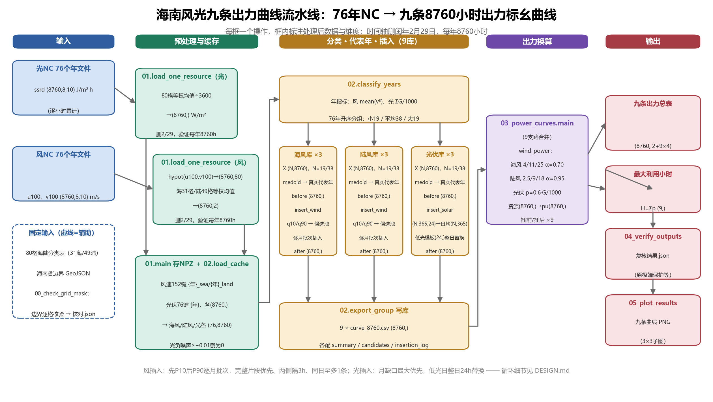

# 海南风光九条出力曲线流水线与服务

## 1. 背景

本项目把海南 1950—2025 年共 76 年的 ERA5 风光资源 NC 数据（风 u100/v100、光伏 ssrd，8×10 网格共 80 格）加工为 9 条 8760 小时归一化出力曲线：海风/陆风/光伏 × 大/平均/小资源年，并封装为 HTTP 服务。输入是 hainan 目录下的 wind/、solar/ 两族 NC 文件，输出是 9 个资源库四件套、九条 8760 小时资源与出力总表、最大利用小时表与复核报告。

## 2. Quick Start

> 本章给出环境安装、算法运行与服务启动的最小命令。

```bash
# 环境：conda 环境 power_curve（python 3.12 + numpy netCDF4 matplotlib fastapi uvicorn httpx）
conda activate power_curve

# 方式一：直接跑算法（CLI）
cd refactor
python -c "from curve_pipeline import run_pipeline; \
    print(run_pipeline({'hainan_dir': r'../hainan'})['状态'])"

# 方式二：起服务
cd refactor
python start_server.py --port 8000        # 结果根目录：环境变量 CURVE_OUTPUTS_ROOT，缺省 refactor/regression_out

# 回归比对（重构版 vs 原始包基准，判据见 DESIGN.md）
python tests/compare_outputs.py

# 接口测试（含一次真实端到端任务，约2-4分钟）
python tests/test_api.py
```

## 3. 架构

> 本章给出分层结构与各层职责。

```
HTTP 客户端
    │  JSON over HTTP（统一响应 {success, message, data, timestamp}）
┌───▼────────────────────────────────────────┐
│ curve_service  服务层                       │
│   api/server/app_server.py  应用装配        │
│   api/routers/curve_router.py  路由         │
│   api/schema/curve_schema.py  请求体        │
│   api/dependencies.py  JobManager 单例      │
│   core/manager/job_manager.py  后台任务     │
│   core/results.py  结果读取                 │
├────────────────────────────────────────────┤
│ curve_pipeline  算法层（唯一入口 run_pipeline）│
│   grid_mask → nc_cache → classify_cluster  │
│   → power_curves → verify_outputs → plot   │
├────────────────────────────────────────────┤
│ hainan/ NC 输入  →  输出根目录（NPZ/9库/CSV/PNG）│
└────────────────────────────────────────────┘
```

依赖单向自上而下：服务层只经 `run_pipeline` 调算法层，算法层不感知 HTTP。

| 模块               | 职责                             | 编写规则                     |
| ------------------ | -------------------------------- | ---------------------------- |
| curve_service/api  | 应用装配、路由、请求体、统一响应 | service-api                  |
| curve_service/core | 后台任务编排、结果文件读取       | service-api、code-decoupling |
| curve_pipeline     | 六步算法，纯 dict 进出           | algo-porting、code-function  |
| refactor/tests     | 回归比对、接口测试               | process-verify               |

## 4. 算法全流程

> 本章是端到端数据流主线：NC 读数 → 网格校验与缓存 → 分类选年与插入 → 出力换算 → 复核与画图。



维度流转的完整描述（每个张量完整形状、非显然轴当场解释、与上图逐层对应）固定在 [NEW_ENERFGY_ALGO_DESIGN.md](NEW_ENERFGY_ALGO_DESIGN.md)。

各步骤与代码模块的对应见下表：

| 步骤                | 输入                                                                                                   | 中间处理                                                                                                         | 输出                                                                                                 | 模块                    |
| ------------------- | ------------------------------------------------------------------------------------------------------ | ---------------------------------------------------------------------------------------------------------------- | ---------------------------------------------------------------------------------------------------- | ----------------------- |
| 0 海陆核验          | 80网格海陆分类.csv、海南省边界 GeoJSON [1]                                                             | 网格自洽校验：8×10 网格、31 海 49 陆，坐标与边界匹配                                                            | 网格海陆核对.json（包 data 目录）                                                                    | grid_mask.py [1]        |
| 1 NC转缓存          | hainan/wind/*.nc（u100,v100 (8760,8,10)×76年）、hainan/solar/ssrd/*.nc（ssrd (8760,8,10)×76年）[2] | 风：hypot(u,v) → (8760,80)，海/陆网格等权均值 → (8760,)；光：网格均值/3600 → (8760,)；2月29日剔除             | 海陆两类_76年8760小时风速.npz（键 {年}_sea/{年}_land）、光伏76年资源缓存.npz（键 {年}），各 76×8760 | nc_cache.py [2]         |
| 2a 分类             | 两个 NPZ                                                                                               | 风指标 mean(v³)、光指标 ΣG/1000，76 年排序切 19/38/19 → 小/平均/大                                            | classifications_and_results.json（三类年份与指标）                                                   | classify_cluster.py [3] |
| 2b 选代表年         | 各库 19/38/19 年的 (8760,) 序列                                                                        | k=1 K-medoids：库内真实年欧氏距离和最小者为代表真实年                                                            | 各库 summary.json 的 代表年                                                                          | classify_cluster.py [3] |
| 2c 风插入（仅风库） | 代表年 (8760,)+全库年序列                                                                              | P10/P90 片段插入：≥3h 连续越阈片段、配额（缺口>6h→半量，3—6h→3 段）、段间 3h 间隔、每日 1 段、必要时前缀截断 | 各库 insertion_log.csv、curve_8760.csv                                                               | wind_insert.py [4]      |
| 2d 光插入（仅光库） | 代表年 (8760,)+全库年序列                                                                              | 低光日整日替换：日均辐射 P10 以下天数补到历史分位，1—2 日模板                                                   | 同上                                                                                                 | solar_insert.py [5]     |
| 3 出力换算          | 9 库 curve_8760.csv [6]                                                                                | 风：切入/额定/切出/α 功率曲线；光：0.6·G/1000                                                                  | 九条8760小时_插前插后资源与出力.csv（8760×38）、九条曲线_最大利用小时.csv、参数与计算结果.json      | power_curves.py [6]     |
| 4 复核              | 步骤 2—3 全部输出                                                                                     | 分组核对 9 组×8760h、插入计数与目标一致性，不通过即报错                                                         | 复核结果.json                                                                                        | verify_outputs.py [7]   |
| 5 画图（可选）      | 九条 CSV                                                                                               | 3×3 曲线图                                                                                                      | 九条8760小时_插前插后资源与出力.png                                                                  | plot_results.py [8]     |

## 5. 分实体明细

> 本章按资源库类型展开 9 个实体的描述、约束、换算成本与输入输出。

| 类型   | 实体（库目录名）                             |
| ------ | -------------------------------------------- |
| 海风库 | wind_sea_high、wind_sea_mid、wind_sea_low    |
| 陆风库 | wind_land_high、wind_land_mid、wind_land_low |
| 光伏库 | solar_high、solar_mid、solar_low             |

| 实体   | 描述                             | 约束                                                  | 成本（换算参数）                                  |
| ------ | -------------------------------- | ----------------------------------------------------- | ------------------------------------------------- |
| 海风库 | 海上 31 格平均风速的代表性年曲线 | 大/平均/小年由 mean(v³) 排序切分；代表年为库内真实年 | 切入 4 / 额定 11 / 切出 25 m/s，α=0.70           |
| 陆风库 | 陆上 49 格平均风速的代表性年曲线 | 同上，按陆风指标独立排序                              | 切入 2.5 / 额定 9 / 切出 18 m/s，α=0.95          |
| 光伏库 | 80 格平均辐照度的代表性年曲线    | 大/平均/小年由 ΣG/1000 排序切分；低光日整日替换      | 0.6·G/1000（G 为 W/m²，除以 3600 后的小时均值） |

| 实体             | 输入数据                                | 输出数据                                                                                  |
| ---------------- | --------------------------------------- | ----------------------------------------------------------------------------------------- |
| 各库（9 个同构） | 库内全部年份 (8760,) 序列（步骤 1 NPZ） | summary.json、candidates.csv、insertion_log.csv、curve_8760.csv（插前/插后资源，8760 行） |

## 6. 汇总输出

> 本章列出输出根目录全部产物与产出模块。

| 文件                                                          | 内容                                                 | 产出模块                                |
| ------------------------------------------------------------- | ---------------------------------------------------- | --------------------------------------- |
| 海南海陆全网格等权方案/海陆两类_76年8760小时风速.npz          | 76 年海/陆平均风速缓存                               | nc_cache.py [2]                         |
| 海南年聚类与月聚类公平对照/光伏76年资源缓存.npz               | 76 年光伏辐照缓存                                    | nc_cache.py [2]                         |
| 风光完整分类聚类插入程序结果/classifications_and_results.json | 三类年份、指标、各库代表年                           | classify_cluster.py [3]                 |
| 风光完整分类聚类插入程序结果/{库}/summary.json                | 库元数据：代表年、距离和、插入次数、修改小时         | classify_cluster.py [3]                 |
| 风光完整分类聚类插入程序结果/{库}/candidates.csv              | 候选片段列表                                         | wind_insert.py [4]、solar_insert.py [5] |
| 风光完整分类聚类插入程序结果/{库}/insertion_log.csv           | 每次插入的日志                                       | wind_insert.py [4]、solar_insert.py [5] |
| 风光完整分类聚类插入程序结果/{库}/curve_8760.csv              | 插前/插后资源，8760 行（列集冻结）                   | classify_cluster.py [3]                 |
| 九条出力曲线_原参数/九条8760小时_插前插后资源与出力.csv       | 9 曲线×(插前/插后资源+出力pu)，8760×38（列集冻结） | power_curves.py [6]                     |
| 九条出力曲线_原参数/九条曲线_最大利用小时.csv                 | 9 行利用小时与增减（列集冻结）                       | power_curves.py [6]                     |
| 九条出力曲线_原参数/参数与计算结果.json                       | 换算参数与结果摘要                                   | power_curves.py [6]                     |
| 九条出力曲线_原参数/九条8760小时_插前插后资源与出力.png       | 3×3 曲线图（可选步骤）                              | plot_results.py [8]                     |
| 复核结果.json                                                 | 9 组×8760h 复核结论                                 | verify_outputs.py [7]                   |
| 运行来源与程序版本.json                                       | 运行环境印记（含时间戳，不参与回归比对）             | 原版兼容产物                            |

结果比对基准件：`refactor/baseline_md5.csv`（原始包全量重跑的 md5 快照，列集冻结）；比对判据与结论见 DESIGN.md。

## 7. 接口

> 本章给出 6 个 HTTP 端点的传参与返回示例。

统一响应包装：`{success, message, data, timestamp}`；业务错误 400，资源不存在 404，未处理异常 500。

### GET /api/health

无传参。

```json
{"status": "ok", "message": "服务运行中", "timestamp": "2026-10-22T05:18:53Z"}
```

> status：服务状态；message：说明；timestamp：UTC 时间。

### POST /api/curve/jobs —— 提交流水线任务

```json
{"hainan_dir": "C:/Users/weiyutao/20260823/new_energy_curve/hainan"}
```

> hainan_dir：必填，包含 wind/、solar/ 的数据目录绝对路径，任务后台跑全流程（约2-4分钟）。

```json
{"success": true, "message": "任务已提交", "data": {"job_id": "3fa2b1c9d0e8"}, "timestamp": "..."}
```

> job_id：任务ID，用于状态查询。

### POST /api/curve/jobs/status —— 查询任务状态

```json
{"job_id": "3fa2b1c9d0e8"}
```

> job_id：必填，POST /api/curve/jobs 返回的任务ID。

```json
{"success": true, "message": "查询成功",
 "data": {"status": "running", "progress": 0.5, "detailed_status": "步骤3/5 出力换算 完成", "error_message": ""},
 "timestamp": "..."}
```

> status：任务状态（running/succeeded/failed）；progress：进度 0~1；detailed_status：步骤描述；error_message：失败原因，成功为空。

### GET /api/curve/libraries —— 九库摘要

无传参。返回 `data` 为 9 行：

```json
{"library": "wind_sea_high", "曲线名": "海风_大风资源年", "资源类型": "wind",
 "代表年": 1988, "代表年欧氏距离和": 5996.17, "插入次数": 20, "修改小时": 167,
 "插入前最大利用小时_h": 1996.33, "插入后最大利用小时_h": 2001.88, "换算参数": "风机4/11/25m/s，α=0.7"}
```

> library：库目录名；曲线名：中文名；资源类型：wind/solar；代表年：k=1 medoid 选出的真实年；代表年欧氏距离和：选年依据；插入次数/修改小时：步骤 2c/2d 结果；插前/插后最大利用小时_h：步骤 3 结果；换算参数：功率曲线参数。

### POST /api/curve/results/curve —— 单库 8760 小时曲线

```json
{"library": "wind_sea_high"}
```

> library：必填，库目录名，取值见 GET /api/curve/libraries。

```json
{"sheet_name": "海风_大风资源年", "index": ["01-01 00:00", "01-01 01:00"],
 "data": [{"column_name": "海风_大风资源年_插前资源", "data": ["9.68", "9.41"]},
          {"column_name": "海风_大风资源年_插后资源", "data": ["9.68", "9.41"]},
          {"column_name": "海风_大风资源年_插前出力pu", "data": ["0.42", "0.39"]},
          {"column_name": "海风_大风资源年_插后出力pu", "data": ["0.42", "0.39"]}]}
```

> sheet_name：曲线名；index：8760 个"月-日 时:分"时间戳；data[].column_name：列名（插前/插后资源、插前/插后出力pu）；data[].data：8760 个值，与 index 对齐。

### GET /api/curve/results/summary —— 汇总

无传参。返回 `data`：

```json
{"九条最大利用小时": [{"曲线": "海风_大风资源年", "插入前最大利用小时_h": "1996.33",
                     "插入后最大利用小时_h": "2001.88", "增减_h": "5.54", "换算参数": "风机4/11/25m/s，α=0.7"}],
 "复核结果": {"通过": true, "错误": [], "检查组数": 9, "每组小时数": 8760},
 "代表年": {"wind_sea_high": 1988, "solar_low": 1985}}
```

> 九条最大利用小时：9 行利用小时表；复核结果：步骤 4 结论；代表年：9 库代表年（键为库目录名）。

## 8. Reference

> 本章为正文编号引用与代码位置的映射。

```markdown
<!-- 算法层 curve_pipeline -->
[1]: refactor/curve_pipeline/grid_mask.py
[2]: refactor/curve_pipeline/nc_cache.py
[3]: refactor/curve_pipeline/classify_cluster.py
[4]: refactor/curve_pipeline/wind_insert.py
[5]: refactor/curve_pipeline/solar_insert.py
[6]: refactor/curve_pipeline/power_curves.py
[7]: refactor/curve_pipeline/verify_outputs.py
[8]: refactor/curve_pipeline/plot_results.py
<!-- 服务层 curve_service -->
[9]: refactor/curve_service/api/server/app_server.py
[10]: refactor/curve_service/api/routers/curve_router.py
[11]: refactor/curve_service/core/manager/job_manager.py
[12]: refactor/curve_service/core/results.py
<!-- 测试 -->
[13]: refactor/tests/compare_outputs.py
[14]: refactor/tests/test_api.py
```
